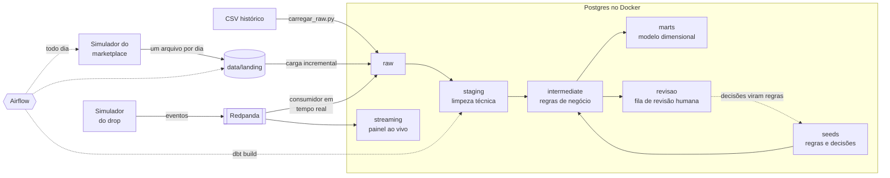
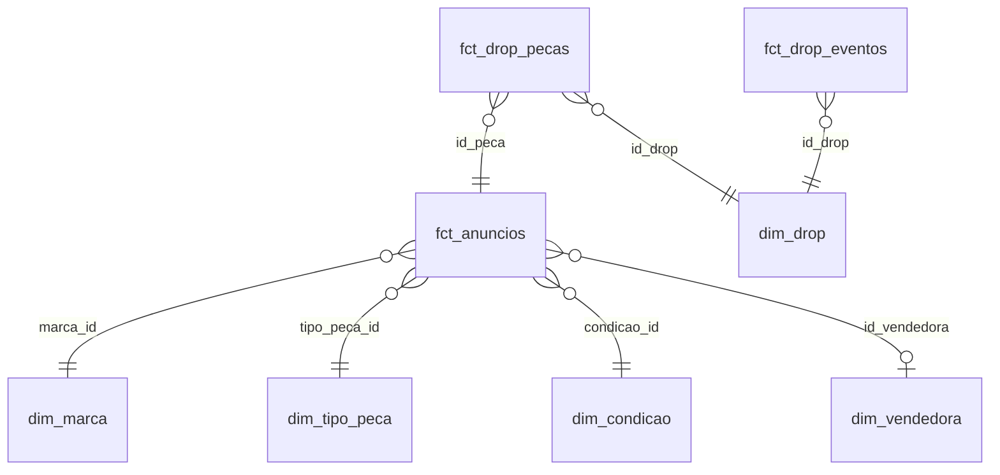

# Marketplace de brechó: pipeline de dados

[](https://github.com/tati0wh/brecho-pipeline/actions/workflows/ci.yml)

Pipeline de engenharia de dados para um marketplace de roupas de segunda mão,
de ponta a ponta: **batch, streaming, orquestração e qualidade de dados**.

O ponto de partida é uma base de **38.582 anúncios** cadastrados por vendedoras,
com texto livre, encoding quebrado e preços em formatos misturados. O pipeline
transforma esses dados em informação limpa, padronizada, testada e organizada
num modelo dimensional. Em cima disso, um marketplace simulado gera anúncios
novos todos os dias (orquestrado pelo Airflow), e um "drop" de peças é
processado em tempo real com Redpanda.

## Por que este projeto

Na faculdade, trabalhei com esta base num notebook do Google Colab: limpei os
dados e criei regras para padronizar marcas, cores, tamanhos e tipos de peça,
tudo à mão, em Python. Neste projeto, refaço esse trabalho do jeito que ele
seria feito em produção: com camadas, regras de negócio versionadas em tabelas,
testes automáticos, revisão humana das decisões difíceis e um ambiente que
qualquer pessoa consegue reproduzir. E depois levo o pipeline além da base
parada: dados chegando todo dia e eventos em tempo real.

O problema central é comum em marketplaces: **cada vendedora escreve do seu
jeito**. A mesma marca aparece como "Zara", "zara", "zaraa" e "zara woman";
o mesmo tamanho como "P", "p" e "36"; a mesma condição como "Novo com etiqueta"
e "nova com etiqueta". Sem padronização, não dá para filtrar, agrupar ou comparar.

## Arquitetura



| Camada | O que faz | Materialização |
|---|---|---|
| **raw** | Cópia fiel dos dados: CSV histórico, anúncios do marketplace, vendedoras e eventos dos drops. Nenhum valor é alterado. | tabela |
| **staging** | Corrige encoding, limpa espaços, converte preços para número, transforma vazios em nulo. Junta histórico e marketplace. Sem regras de negócio. | view |
| **seeds** | As regras de negócio e as decisões de revisão, em CSVs editáveis. | tabela |
| **intermediate** | Aplica as regras. Cada campo padronizado fica ao lado do valor original e do método usado. | view / tabela |
| **marts** | Modelo dimensional (esquema estrela) para análise. | tabela |
| **revisao** | Fila de sugestões de fuzzy matching para uma pessoa revisar, e auditoria do que foi aceito automaticamente. | tabela |
| **streaming** | Painel do drop, atualizado em tempo real pelo consumidor. | tabela |

## Tecnologias

- **PostgreSQL 16** em **Docker**, com as extensões `unaccent` e `pg_trgm`
- **dbt Core 1.12** para as transformações, testes e documentação
- **Apache Airflow 3** para a orquestração diária
- **Redpanda** (compatível com Kafka) para o streaming
- **Python** (pandas, SQLAlchemy, Faker, confluent-kafka) para cargas e simuladores
- **GitHub Actions** para o CI

## Resultados

| Problema | Antes | Depois |
|---|---|---|
| Nomes de peça com acentos quebrados ("Sandália") | 12.467 | 1 |
| Grafias diferentes de marca | 7.106 | 6.372 marcas |
| Valores de condição | 5 | 4 |
| Peças com tipo identificado | – | 38.567 de 38.582 (99,96%) |
| Peças com grupo de cor | – | 38.453 de 38.582 (99,7%) |
| Sugestões de fuzzy matching da base histórica revisadas | – | 238 de 238 |
| Testes automáticos | – | 107 |

## Modelo dimensional



**Anúncios**

- **`fct_anuncios`:** uma linha por peça anunciada (histórico e marketplace).
  Preço de venda, preço original, desconto em reais e em %, cor, tamanho, data
  de cadastro e sinalizadores de qualidade (`preco_suspeito`, `tem_preco_original`).
- **`dim_marca`:** uma linha por marca, com hierarquia e faixa de preço (abaixo).
- **`dim_tipo_peca`:** 21 tipos de peça, agrupados em Roupa, Calçado, Bolsa,
  Acessório e Outros.
- **`dim_condicao`:** 4 condições, com a ordem de conservação.
- **`dim_vendedora`:** uma linha por vendedora do marketplace, com o volume de
  anúncios e **indicadores de qualidade do cadastro** (% sem tamanho, % sem cor,
  % de marcas que precisaram de regra).

**Drops**

- **`fct_drop_eventos`:** uma linha por clique, com a marcação de suspeita de bot.
- **`fct_drop_pecas`:** uma linha por peça em cada drop: funil, compras
  recusadas por disputa e tempo até vender, ligada à marca e ao tipo de peça.
- **`dim_drop`:** uma linha por drop: peças vendidas, receita, disputas, bots,
  latência e o funil de clientes (viram → carrinho → compraram).

As chaves de marca, tipo e condição são `md5` do nome padronizado, então
continuam as mesmas entre execuções. Testes de `relationships` garantem que
nenhum fato aponta para uma dimensão que não existe.

### Hierarquia de marcas

A `dim_marca` guarda sempre o nível mais detalhado ("Zara Kids") e permite
subir de nível na análise:

| Coluna | O que é | Exemplo |
|---|---|---|
| `marca` | o nome mais específico | Zara Kids, Blue Steel, Maria Filó para C&A |
| `marca_mae` | a marca principal da linha | Zara, Blue Steel, Maria Filó |
| `grupo` | a empresa ou varejista dono da marca | –, Renner, C&A |
| `segmento` | o tipo de linha | Infantil, Bebê, Juvenil, Masculino, Esportivo, Jeans, Básico |
| `e_collab` / `marca_parceira` | se é uma colaboração, e com quem | Maria Filó **para** C&A; Farm **x** Adidas |
| `faixa_preco` | pelo preço mediano no brechó | Acessível, Intermediária, Premium, Luxo |

Nas collabs, "para" indica uma coleção assinada por uma marca e produzida e
vendida pela outra; "x" indica uma parceria vendida pelas duas. Marcas com
menos de 5 peças ficam com a faixa "Poucos dados".

### O que os dados mostram

- **O brechó parece ter uma política de preço.** Das 23 marcas com 200 peças
  ou mais, 21 são revendidas, em média, com 65% a 73% de desconto sobre o preço
  da peça nova. As exceções são a Carter's (61%) e a Bazar Genial (43%).
- **Collabs revendem a preço de varejo.** Peças de collab custam em média
  R$ 26 no brechó, perto da C&A e da Riachuelo sozinhas (R$ 23) e muito longe
  das marcas que assinam (R$ 132). A amostra é pequena (14 peças).
- **O estoque é intermediário.** 40% das peças são de marcas da faixa
  Intermediária (Zara, Farm, Animale), e o luxo é menos de 2%.
- **A qualidade do cadastro aparece por vendedora.** No marketplace simulado,
  a `dim_vendedora` identifica, só pelos dados, as vendedoras que deixam cerca
  de 35% dos anúncios sem tamanho e sem cor.

## Como as regras funcionam

### Três camadas de decisão

1. **Normalização automática:** cada valor ganha uma "chave de comparação"
   (minúsculas, sem acento, sem pontuação). "Maria Filó", "maria filo" e
   "maria filÓ" viram a mesma chave, `maria filo`.
2. **Escolha automática:** entre as grafias de uma mesma chave, vale a mais
   comum que tenha letra maiúscula ("Zara" ganha de "zara").
3. **Regras de negócio (seeds):** o que a automação não resolve fica num CSV,
   com uma coluna explicando o motivo de cada regra. A regra sempre vence a
   automação.

### Fuzzy matching e revisão humana (human in the loop)

Erros de digitação ("luigi bertollli", "tommy hilfigier") não são pegos pela
normalização. Para eles, o modelo `int_marcas_sugestoes` compara as marcas raras
com as marcas comuns (20 peças ou mais) usando similaridade de trigramas
(`pg_trgm`), com e sem espaços ("levis" × "Levi's"), e sugere a mais parecida.
O que acontece com cada sugestão depende da similaridade:

| Similaridade | O que acontece |
|---|---|
| a partir de 0,85 | **aceite automático**, com o método `fuzzy_automatico` registrado em cada peça e listado em `revisao_marcas_aceitas_automaticamente` para auditoria |
| de 0,50 a 0,85 | vai para a **fila de revisão humana** (`revisao_marcas_parecidas`) |
| abaixo de 0,50 | não vira sugestão |

Na revisão, a sugestão certa vira regra no `map_marca`; a errada vai para o
`revisao_marcas_rejeitadas`, com o motivo. Rejeitar também desfaz um aceite
automático errado. Os limiares ficam no `dbt_project.yml` e são decisões de
negócio: mais alto é mais seguro, mais baixo dá menos trabalho.

A revisão manual fez diferença. O algoritmo sugeriu "Jes Couture" → Juicy
Couture, "St. John" → John John e "A.L.C." → C&A, todas erradas; e não tinha
como saber que "ALK" é a leitura errada do logo da AK by Riachuelo, que "A+"
é um código de curadoria e não uma linha da Animale, ou que "Maria Filó para
C&A" não deve entrar na média de preço da Maria Filó.

### Rastreabilidade

Nenhuma informação é sobrescrita. Para cada campo, a tabela final guarda:

| Coluna | Exemplo |
|---|---|
| valor original | `sem etiqueta` |
| valor padronizado | `Sem marca` |
| método | `mapeamento` |
| palavra que decidiu | `jeans` |

Assim, qualquer resultado pode ser explicado e, se estiver errado, sei
exatamente qual regra mudar.

### Seeds de regras

| Seed | Linhas | O que guarda |
|---|---|---|
| `map_condicao` | 5 | grafias de condição → 4 condições, com ordem de conservação |
| `map_marca` | 191 | grafias oficiais, erros de digitação, linhas e collabs |
| `map_marca_hierarquia` | 72 | marca mãe, grupo, segmento e collabs |
| `revisao_marcas_rejeitadas` | 73 | sugestões revisadas e rejeitadas, com o motivo |
| `map_marca_inferida` | 33 | termos que indicam a marca em peças "sem etiqueta" |
| `map_tipo_peca` | 440 | palavras → 21 tipos de peça, com prioridade |
| `map_cor` | 156 | palavras → 18 grupos de cor |
| `map_tamanho` | 102 | letras, números, meses e anos, com equivalência numérica |

## O marketplace vivo (batch diário)

Um simulador faz o papel do site: vendedoras com nome, cidade e um "jeito de
escrever" (caprichosa, apressada, caixa alta ou esquecida) cadastram peças
sorteadas da base histórica, com erros de digitação, campos faltando e preços
no formato do site original. O simulador **não lê o banco**: como o sistema de
um site de verdade, ele só grava arquivos.

```
gerar_anuncios  ──►  carregar_novos  ──►  dbt_build
(o site funciona)    (raw recebe o novo)   (transforma e testa)
```

- **Zona de chegada particionada por data** (`data/landing/anuncios/data=AAAA-MM-DD/`).
- **Carga incremental e idempotente:** a tabela `raw._controle_cargas` guarda
  um hash do conteúdo de cada arquivo. Arquivo novo entra; arquivo já carregado
  é pulado; arquivo que mudou tem as linhas antigas substituídas, numa transação.
- **Airflow 3** roda as três tarefas numa DAG diária (`dags/pipeline_brecho.py`).
  Se uma tarefa falha, as seguintes não rodam, e cada uma tenta de novo uma vez.
  Dá para disparar à mão escolhendo o dia, para preencher dias passados.
- **As regras valem para os dados novos sem nenhuma mudança:** a staging junta
  histórico e marketplace, e todo o resto do pipeline lê dela. Os erros de
  digitação das vendedoras simuladas aparecem sozinhos no fuzzy matching.

## O drop ao vivo (streaming)

Um "drop" é quando o brechó solta várias peças únicas num horário marcado e
centenas de clientes correm para comprar. Cada clique vira um evento:
`visualizou_peca`, `curtiu`, `adicionou_ao_carrinho`, `removeu_do_carrinho`,
`comprou` ou `compra_recusada` (alguém tentou comprar uma peça já vendida).

```
simular_drop.py  ──►  Redpanda (tópico drop_eventos)  ──►  processar_drop.py  ──►  Postgres
```

- **Partições com chave:** o tópico tem 3 partições, e cada evento é enviado
  com o código da peça como chave. Os eventos de uma mesma peça ficam sempre na
  mesma partição, em ordem.
- **Os problemas típicos de streaming, de propósito:** pico de acessos no
  início, eventos duplicados, eventos atrasados (fora de ordem), disputa pela
  mesma peça e bots.
- **O consumidor**, em tempo real, descarta duplicados pelo `id_evento`, mede a
  diferença entre o tempo do evento e o tempo de processamento, detecta bots com
  uma janela deslizante (mais de 10 carrinhos em 10 segundos), enriquece os
  eventos com nome e marca buscados no banco e atualiza um painel a cada 2 segundos.
- **Batch e streaming se encontram:** os mesmos eventos alimentam os modelos de
  drop no dbt, que recalculam o funil, o tempo até vender e os bots com SQL
  (`range between interval '10 seconds' preceding and current row`). Os dois
  caminhos chegam aos mesmos números.

Num drop simulado de 60 segundos, com 30 peças e 300 clientes: 23 peças
vendidas, 13 compras recusadas por disputa, 2 bots detectados, e um funil de
284 clientes que viram → 84 que colocaram no carrinho → 23 que compraram.

## CI (GitHub Actions)

A cada push, o GitHub sobe um Postgres temporário e roda o pipeline inteiro:
gera uma **base histórica sintética**, carrega, simula dois dias do marketplace,
simula um drop e roda o `dbt build` **duas vezes** (para garantir que o pipeline
é idempotente).

- **Dados sintéticos sem dados reais:** como o CSV original não está no
  repositório, `ci/gerar_amostra.py` inventa anúncios usando os próprios seeds
  como dicionário, com a mesma bagunça dos dados reais (acentos quebrados,
  grafias variadas, vírgula no milhar).
- **Drop sem Redpanda:** como a lógica do streaming foi escrita separada da
  comunicação, `ci/simular_drop_sem_kafka.py` usa as mesmas funções do drop de
  verdade, só sem o transporte.

## Decisões e aprendizados

**Modelagem e regras**

- **O raw é sagrado.** Os dados entram exatamente como vieram, e toda limpeza
  acontece em camadas derivadas. Se uma regra estiver errada, basta corrigir e
  reprocessar.
- **Limpeza técnica separada de regra de negócio.** A staging só conserta o que
  é objetivamente errado (encoding, tipos). Unificar "Zara" e "zara woman" é
  uma decisão de negócio e fica na camada intermediate.
- **Escrever a limpeza uma vez só.** As regras técnicas viraram macros
  (`macros/limpeza.sql`), usadas pelo histórico e pelo marketplace. Se mudarem,
  mudam para os dois.
- **Guardar o detalhe, agregar pela hierarquia.** Na dúvida entre separar
  "Zara Kids" ou juntar em "Zara", as duas coisas: a linha fica como marca
  própria e a `marca_mae` permite somar. Do detalhe dá para chegar ao geral;
  do geral, nunca se volta ao detalhe.
- **Na dúvida, não juntar.** Juntar duas marcas diferentes distorce as
  estatísticas das duas sem ninguém perceber. Casos indeterminados ficam
  separados, com o motivo registrado.
- **Comparação por palavra inteira.** No notebook original, buscar `red` dentro
  do texto fazia "decote a*rred*ondado" virar vermelho (308 peças afetadas, só
  88 eram de fato vermelhas). No pipeline, as regras comparam palavras inteiras.
- **Usar o dado informado antes de inferir.** O notebook inferia a cor pelo texto
  e descartava a coluna `Cores`, preenchida em 98% das peças. O pipeline usa a
  cor informada e só infere pelo texto quando ela falta, registrando o método.
- **Listas fechadas evitam sinônimos.** Os segmentos de marca têm uma lista de
  valores permitidos, depois que "Fitness" e "Esportivo" apareceram para a
  mesma coisa.
- **Imputação não é papel da camada de dados.** Preço vazio fica vazio. Preencher
  com a média é decisão do modelo de ML, numa camada própria de features.

**Qualidade e revisão**

- **Automação que sugere, pessoa que decide.** O fuzzy matching erra (sugeriu
  "Um Mais Um", marca infantil, como "Mais um", com similaridade 1,0). Por isso,
  todo aceite automático é registrado e reversível.
- **Um gabarito para medir o algoritmo.** Como os erros de digitação do
  marketplace foram criados pelo simulador, dá para saber a resposta certa:
  todas as sugestões para esses erros estavam corretas, mesmo as de baixa
  confiança.
- **Prevenir é melhor que corrigir.** Revisar erros novos todo dia não escala.
  O aceite automático ajuda, mas a solução definitiva seria no site: um
  autocompletar de marcas no cadastro ("shift left").
- **A revisão humana também acha bugs.** Revisando a fila, apareceu um
  "Carter’s": um apóstrofo curvo quebrado que a função de encoding não
  tratava. A correção juntou 136 peças à Carter's, que passou a ter 296.
- **Views escondem erros.** A conversão de preço falhava em 51 peças com vírgula
  como separador de milhar ("1,000,00"), mas o erro só apareceu quando uma tabela
  leu a coluna inteira. Um teste agora força a leitura completa dos preços.

**Engenharia**

- **Idempotência em todo lugar.** Rodar de novo nunca duplica: a carga do CSV
  troca o conteúdo da tabela, a carga incremental usa o hash de cada arquivo, o
  consumidor do drop grava com `on conflict do nothing` e o simulador não cria
  vendedoras repetidas ao regerar um dia. O CI roda o `dbt build` duas vezes
  para conferir.
- **Esvaziar em vez de apagar.** Recriar uma tabela do raw quebrava quando as
  views do dbt dependiam dela. As cargas passaram a esvaziar a tabela
  (`TRUNCATE`) e inserir de novo, numa transação. O teste da DAG no Airflow
  pegou o problema antes que ele aparecesse.
- **Separar a lógica do transporte.** A geração e o processamento dos eventos
  do drop não dependem do Redpanda. Isso permitiu testar a lógica sem o broker
  e rodar o drop no CI.
- **Ambientes separados no Airflow.** O dbt e as bibliotecas do projeto ficam
  num ambiente Python à parte dentro da imagem do Airflow, para evitar conflito
  de dependências.
- **Nenhum segredo no Git.** Senhas ficam no `.env`, lido pelo Docker, pelos
  scripts e pelo dbt (que, a partir da versão 1.12, carrega o `.env` sozinho).
  O repositório só tem o `.env.example`, e o CI usa um banco temporário.

## Como rodar

### Pré-requisitos

- Docker Desktop (com pelo menos 4 GB de memória para o Airflow)
- Python 3.12
- Git

### Batch (Windows / PowerShell)

```powershell
# 1. Configuração
copy .env.example .env          # depois edite o .env e defina uma senha

# 2. Banco de dados
docker compose up -d

# 3. Ambiente Python
py -3.12 -m venv .venv
.\.venv\Scripts\Activate.ps1
pip install -r requirements.txt

# 4. Carga dos dados brutos
python scripts\carregar_raw.py data\raw\roupas_usadas.csv

# 5. Alguns dias do marketplace
python scripts\simulador\gerar_anuncios.py --data 2026-11-24
python scripts\simulador\gerar_anuncios.py --data 2026-11-25
python scripts\carregar_novos.py

# 6. Transformações e testes (o dbt lê o .env sozinho)
dbt build

# 7. Documentação, com o gráfico de linhagem
dbt docs generate
dbt docs serve --port 8081
```

O `dbt build` deve terminar sem erros (`ERROR=0`). Os avisos esperados são as
peças com preço no brechó maior que o da peça nova (provável erro de cadastro)
e as sugestões de marca de alta confiança ainda não revisadas.

Sempre que um seed ganhar ou perder colunas, rode uma vez com
`dbt build --full-refresh`.

### Airflow

```powershell
docker compose --profile airflow up -d --build   # na primeira vez, demora alguns minutos
docker logs -f brecho_airflow                     # espere "Airflow is ready" e saia com Ctrl+C
```

Abra http://localhost:8080, ative a DAG `pipeline_brecho` e dispare com o
botão Trigger (o parâmetro `data` permite gerar um dia específico).

### Drop em streaming

```powershell
docker compose --profile streaming up -d          # Redpanda e Redpanda Console
python scripts\streaming\processar_drop.py        # terminal 1: o consumidor
python scripts\streaming\simular_drop.py          # terminal 2: o drop
```

O painel aparece no terminal 1. O Redpanda Console fica em http://localhost:8085.
Depois do drop, rode `dbt build` para atualizar os modelos de drop.

### Para desligar

```powershell
docker compose stop airflow                        # só o Airflow
docker compose stop redpanda redpanda-console      # só o streaming
docker compose --profile airflow --profile streaming stop   # tudo, inclusive o banco
```

### Sobre os dados

A base original não está no repositório: são anúncios de um brechó online
usados num trabalho da faculdade, e não são meus para redistribuir. Para rodar
o projeto, coloque um CSV com as mesmas colunas em `data/raw/roupas_usadas.csv`,
ou gere uma base sintética com `python ci/gerar_amostra.py`.

## Estrutura

```
.
├── .github/workflows/ci.yml      # CI: pipeline completo a cada push
├── airflow/Dockerfile            # imagem do Airflow com o dbt
├── dags/pipeline_brecho.py       # DAG diária: gerar -> carregar -> dbt build
├── ci/                           # base sintética e drop sem Redpanda, para o CI
├── data/                         # CSV original e zona de chegada (fora do Git)
├── scripts/
│   ├── carregar_raw.py           # carga do CSV histórico
│   ├── carregar_novos.py         # carga incremental do marketplace
│   ├── simulador/                # o "site": vendedoras cadastrando peças
│   └── streaming/                # o drop: simulador e consumidor em tempo real
├── macros/                       # limpeza, normalização e correção de encoding
├── models/
│   ├── staging/                  # limpeza técnica (histórico + marketplace + drops)
│   ├── intermediate/             # regras de negócio e fuzzy matching
│   ├── marts/                    # modelo dimensional
│   └── revisao/                  # fila de revisão humana e auditoria
├── seeds/                        # regras e decisões (CSV)
├── tests/                        # testes próprios
├── analyses/                     # consultas usadas na revisão
├── dbt_project.yml               # inclui os parâmetros (vars) de revisão, faixas de preço e bots
├── profiles.yml                  # conexão, sem senhas
├── docker-compose.yml            # Postgres, Airflow e Redpanda
├── .env.example
└── requirements.txt
```

## Roteiro

- [x] **Etapa 1:** Postgres no Docker e carga do CSV na camada raw
- [x] **Etapa 2:** projeto dbt e camada de staging
- [x] **Etapa 3:** regras de negócio em seeds (condição, marca, tipo de peça, cor, tamanho)
- [x] **Etapa 4:** camada final (marts) com modelo dimensional
- [x] **Etapa 5:** fuzzy matching com fila de revisão humana, hierarquia de marcas, collabs e faixa de preço
- [x] **Etapa 6:** marketplace simulado com carga incremental, aceite automático de marcas e orquestração com Airflow
- [x] **Etapa 7:** drop de peças em streaming com Redpanda, ligado ao modelo dimensional
- [x] CI com GitHub Actions

Ideias para continuar: um dashboard com os marts, uma camada de features para
retomar o modelo de ML do notebook original e o autocompletar de marcas no
simulador, para medir quanto a prevenção reduz a fila de revisão.