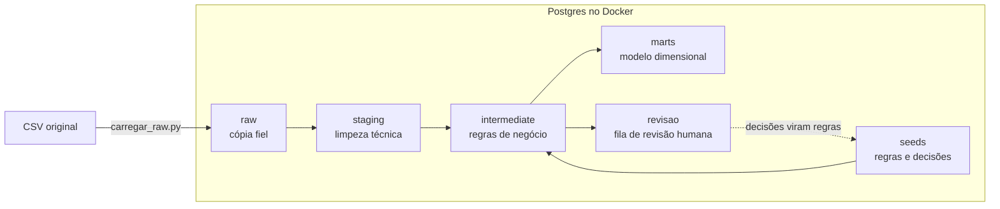
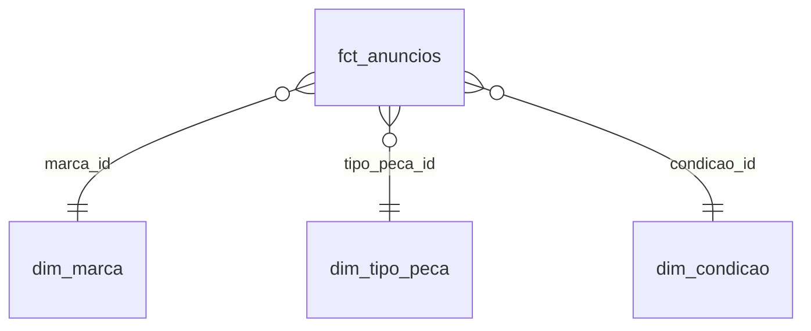

# Marketplace de brechó: pipeline de dados

Pipeline de engenharia de dados para um marketplace de roupas de segunda mão.
O projeto pega uma base de **38.582 anúncios** cadastrados por vendedoras, com
texto livre, encoding quebrado e preços em formatos misturados, e transforma
em dados limpos, padronizados, testados e organizados num modelo dimensional
pronto para análise ou modelagem.

> 🚧 Em construção. Próximas etapas no [roteiro](#roteiro).

## Por que este projeto

Na faculdade, trabalhei com esta base num notebook do Google Colab: limpei os
dados e criei regras para padronizar marcas, cores, tamanhos e tipos de peça,
tudo à mão, em Python. Neste projeto, refaço esse trabalho do jeito que ele
seria feito em produção: com camadas, regras de negócio versionadas em tabelas,
testes automáticos, revisão humana das decisões difíceis e um ambiente que
qualquer pessoa consegue reproduzir.

O problema central é comum em marketplaces: **cada vendedora escreve do seu
jeito**. A mesma marca aparece como "Zara", "zara", "zaraa" e "zara woman";
o mesmo tamanho como "P", "p" e "36"; a mesma condição como "Novo com etiqueta"
e "nova com etiqueta". Sem padronização, não dá para filtrar, agrupar ou comparar.

## Arquitetura



| Camada | O que faz | Materialização |
|---|---|---|
| **raw** | Cópia fiel do CSV. Nenhum valor é alterado. | tabela |
| **staging** | Corrige encoding, limpa espaços, converte preços para número, transforma vazios em nulo. Sem regras de negócio. | view |
| **seeds** | As regras de negócio e as decisões de revisão, em CSVs editáveis. | tabela |
| **intermediate** | Aplica as regras. Cada campo padronizado fica ao lado do valor original e do método usado. | view / tabela |
| **marts** | Modelo dimensional (esquema estrela) para análise. | tabela |
| **revisao** | Fila de sugestões de fuzzy matching para uma pessoa revisar. | tabela |

## Tecnologias

- **PostgreSQL 16** em **Docker**, com as extensões `unaccent` e `pg_trgm`
- **dbt Core 1.12** para as transformações, testes e documentação
- **Python** (pandas, SQLAlchemy) para a carga inicial
- **Git/GitHub** para versionamento

## Resultados

| Problema | Antes | Depois |
|---|---|---|
| Nomes de peça com acentos quebrados ("Sandália") | 12.467 | 1 |
| Grafias diferentes de marca | 7.106 | 6.372 marcas |
| Valores de condição | 5 | 4 |
| Peças com tipo identificado | – | 38.567 de 38.582 (99,96%) |
| Peças com grupo de cor | – | 38.453 de 38.582 (99,7%) |
| Sugestões de fuzzy matching revisadas | – | 238 de 238 |
| Testes automáticos | – | 78 |

## Modelo dimensional



- **`fct_anuncios`:** uma linha por peça anunciada. Preço de venda, preço
  original, desconto em reais e em %, cor, tamanho e sinalizadores de qualidade
  (`preco_suspeito`, `tem_preco_original`).
- **`dim_marca`:** uma linha por marca, com hierarquia e faixa de preço (abaixo).
- **`dim_tipo_peca`:** 21 tipos de peça, agrupados em Roupa, Calçado, Bolsa,
  Acessório e Outros.
- **`dim_condicao`:** 4 condições, com a ordem de conservação.

As chaves são `md5` do nome padronizado, então continuam as mesmas entre
execuções. Testes de `relationships` garantem que nenhum anúncio aponta para
uma dimensão que não existe.

### Hierarquia de marcas

A `dim_marca` guarda sempre o nível mais detalhado ("Zara Kids") e permite
subir de nível na análise:

| Coluna | O que é | Exemplo |
|---|---|---|
| `marca` | o nome mais específico | Zara Kids, Blue Steel, Maria Filó para C&A |
| `marca_mae` | a marca principal da linha | Zara, Blue Steel, Maria Filó |
| `grupo` | a empresa ou varejista dono da marca | –, Renner, C&A |
| `segmento` | o tipo de linha | Infantil, Bebê, Juvenil, Masculino, Esportivo, Jeans, Básico |
| `e_collab` / `marca_parceira` | se é uma colaboração, e com quem | Maria Filó **para** C&A; Farm **x** Adidas |
| `faixa_preco` | pelo preço mediano no brechó | Acessível, Intermediária, Premium, Luxo |

Nas collabs, "para" indica uma coleção assinada por uma marca e produzida e
vendida pela outra; "x" indica uma parceria vendida pelas duas. Marcas com
menos de 5 peças ficam com a faixa "Poucos dados".

### O que os dados mostram

- **O brechó parece ter uma política de preço.** Das 23 marcas com 200 peças
  ou mais, 21 são revendidas, em média, com 65% a 73% de desconto sobre o preço
  da peça nova. As exceções são a Carter's (61%) e a Bazar Genial (43%).
- **Collabs revendem a preço de varejo.** Peças de collab custam em média
  R$ 26 no brechó, perto da C&A e da Riachuelo sozinhas (R$ 23) e muito longe
  das marcas que assinam (R$ 132). A amostra é pequena (14 peças).
- **O estoque é intermediário.** 40% das peças são de marcas da faixa
  Intermediária (Zara, Farm, Animale), e o luxo é menos de 2%.

## Como as regras funcionam

### Três camadas de decisão

1. **Normalização automática:** cada valor ganha uma "chave de comparação"
   (minúsculas, sem acento, sem pontuação). "Maria Filó", "maria filo" e
   "maria filÓ" viram a mesma chave, `maria filo`.
2. **Escolha automática:** entre as grafias de uma mesma chave, vale a mais
   comum que tenha letra maiúscula ("Zara" ganha de "zara").
3. **Regras de negócio (seeds):** o que a automação não resolve fica num CSV,
   com uma coluna explicando o motivo de cada regra. A regra sempre vence a
   automação.

### Fila de revisão (human in the loop)

Erros de digitação ("luigi bertollli", "tommy hilfigier") não são pegos pela
normalização. Para eles, o modelo `revisao_marcas_parecidas`:

1. compara as marcas raras com as marcas comuns (20 peças ou mais) usando
   similaridade de trigramas (`pg_trgm`), com e sem espaços ("levis" × "Levi's");
2. sugere a marca mais parecida, com um grau de confiança (alta, média, baixa);
3. **não muda nada sozinho**: uma pessoa revisa cada sugestão.

Sugestão certa vira regra no `map_marca`; sugestão errada vai para o
`revisao_marcas_rejeitadas`, com o motivo. Nos dois casos, a marca sai da fila
no próximo `dbt build`. Um teste avisa quando há sugestões de alta confiança
pendentes.

A revisão manual fez diferença. O algoritmo sugeriu "Jes Couture" → Juicy
Couture, "St. John" → John John e "A.L.C." → C&A, todas erradas; e não tinha
como saber que "ALK" é a leitura errada do logo da AK by Riachuelo, que "A+"
é um código de curadoria e não uma linha da Animale, ou que "Maria Filó para
C&A" não deve entrar na média de preço da Maria Filó.

### Rastreabilidade

Nenhuma informação é sobrescrita. Para cada campo, a tabela final guarda:

| Coluna | Exemplo |
|---|---|
| valor original | `sem etiqueta` |
| valor padronizado | `Sem marca` |
| método | `mapeamento` |
| palavra que decidiu | `jeans` |

Assim, qualquer resultado pode ser explicado e, se estiver errado, sei
exatamente qual regra mudar.

### Seeds de regras

| Seed | Linhas | O que guarda |
|---|---|---|
| `map_condicao` | 5 | grafias de condição → 4 condições, com ordem de conservação |
| `map_marca` | 191 | grafias oficiais, erros de digitação, linhas e collabs |
| `map_marca_hierarquia` | 72 | marca mãe, grupo, segmento e collabs |
| `revisao_marcas_rejeitadas` | 73 | sugestões revisadas e rejeitadas, com o motivo |
| `map_marca_inferida` | 33 | termos que indicam a marca em peças "sem etiqueta" |
| `map_tipo_peca` | 440 | palavras → 21 tipos de peça, com prioridade |
| `map_cor` | 156 | palavras → 18 grupos de cor |
| `map_tamanho` | 102 | letras, números, meses e anos, com equivalência numérica |

## Decisões e aprendizados

- **O raw é sagrado.** Os dados entram exatamente como vieram, e toda limpeza
  acontece em camadas derivadas. Se uma regra estiver errada, basta corrigir e
  reprocessar.
- **Limpeza técnica separada de regra de negócio.** A staging só conserta o que
  é objetivamente errado (encoding, tipos). Unificar "Zara" e "zara woman" é
  uma decisão de negócio e fica na camada intermediate.
- **Guardar o detalhe, agregar pela hierarquia.** Na dúvida entre separar
  "Zara Kids" ou juntar em "Zara", as duas coisas: a linha fica como marca
  própria e a `marca_mae` permite somar. Do detalhe dá para chegar ao geral;
  do geral, nunca se volta ao detalhe.
- **Na dúvida, não juntar.** Juntar duas marcas diferentes distorce as
  estatísticas das duas sem ninguém perceber. Casos indeterminados ficam
  separados, com o motivo registrado.
- **Comparação por palavra inteira.** No notebook original, buscar `red` dentro
  do texto fazia "decote a*rred*ondado" virar vermelho (308 peças afetadas, só
  88 eram de fato vermelhas). No pipeline, as regras comparam palavras inteiras.
- **Usar o dado informado antes de inferir.** O notebook inferia a cor pelo texto
  e descartava a coluna `Cores`, preenchida em 98% das peças. O pipeline usa a
  cor informada e só infere pelo texto quando ela falta, registrando o método.
- **Conflitos detectados automaticamente.** Ao converter os dicionários do
  notebook em seeds, palavras em duas categorias (como "pantalona" em sapato e
  calça) apareceram e foram resolvidas. Testes de unicidade impedem que voltem.
- **Listas fechadas evitam sinônimos.** Os segmentos de marca têm uma lista de
  valores permitidos, depois que "Fitness" e "Esportivo" apareceram para a
  mesma coisa.
- **A revisão humana também acha bugs.** Revisando a fila, apareceu um
  "Carter’s": um apóstrofo curvo quebrado que a função de encoding não
  tratava. A correção juntou 136 peças à Carter's, que passou a ter 296.
- **Views escondem erros.** A conversão de preço falhava em 51 peças com vírgula
  como separador de milhar ("1,000,00"), mas o erro só apareceu quando uma tabela
  leu a coluna inteira. Um teste agora força a leitura completa dos preços.
- **Imputação não é papel da camada de dados.** Preço vazio fica vazio. Preencher
  com a média é decisão do modelo de ML, numa camada própria de features.
- **Nenhum segredo no Git.** Senhas ficam no `.env`, lido pelo Docker, pelo
  script de carga e pelo dbt (que, a partir da versão 1.12, carrega o `.env`
  sozinho). O repositório só tem o `.env.example`.

## Como rodar

### Pré-requisitos

- Docker Desktop
- Python 3.12
- Git

### Passo a passo (Windows / PowerShell)

```powershell
# 1. Configuração
copy .env.example .env          # depois edite o .env e defina uma senha

# 2. Banco de dados
docker compose up -d

# 3. Ambiente Python
py -3.12 -m venv .venv
.\.venv\Scripts\Activate.ps1
pip install -r requirements.txt

# 4. Carga dos dados brutos
python scripts\carregar_raw.py data\raw\roupas_usadas.csv

# 5. Transformações e testes (o dbt lê o .env sozinho)
dbt build

# 6. Documentação, com o gráfico de linhagem
dbt docs generate
dbt docs serve --port 8081
```

O `dbt build` deve terminar sem erros (`ERROR=0`). O aviso esperado lista as
10 peças cujo preço no brechó é maior que o da peça nova (provável erro de
cadastro).

Sempre que um seed ganhar ou perder colunas, rode uma vez com
`dbt build --full-refresh`.

### Para retomar o trabalho

```powershell
docker compose up -d
.\.venv\Scripts\Activate.ps1
dbt build
```

### Sobre os dados

A base original não está no repositório: são anúncios de um brechó online
usados num trabalho da faculdade, e não são meus para redistribuir. Para rodar
o projeto, coloque um CSV com as mesmas colunas em `data/raw/roupas_usadas.csv`.

## Estrutura

```
.
├── data/raw/                     # CSV original (fora do Git)
├── scripts/
│   └── carregar_raw.py           # carga do CSV na camada raw
├── macros/
│   ├── criar_funcao_corrigir_encoding.sql
│   ├── generate_schema_name.sql
│   └── normalizar_chave.sql
├── models/
│   ├── staging/                  # limpeza técnica
│   ├── intermediate/             # regras de negócio
│   ├── marts/                    # modelo dimensional
│   └── revisao/                  # fila de revisão humana
├── seeds/                        # regras e decisões (CSV)
├── tests/                        # testes próprios
├── analyses/                     # consultas usadas na revisão
├── dbt_project.yml               # inclui os parâmetros (vars) da revisão e das faixas de preço
├── profiles.yml                  # conexão, sem senhas
├── docker-compose.yml
├── .env.example
└── requirements.txt
```

## Roteiro

- [x] **Etapa 1:** Postgres no Docker e carga do CSV na camada raw
- [x] **Etapa 2:** projeto dbt e camada de staging
- [x] **Etapa 3:** regras de negócio em seeds (condição, marca, tipo de peça, cor, tamanho)
- [x] **Etapa 4:** camada final (marts) com modelo dimensional
- [x] **Etapa 5:** fuzzy matching com fila de revisão humana, hierarquia de marcas, collabs e faixa de preço
- [ ] **Etapa 6:** simulação do marketplace (vendedoras cadastrando peças) e orquestração com Airflow
- [ ] **Etapa 7:** "drop" de peças em streaming com Redpanda
- [ ] CI com GitHub Actions
