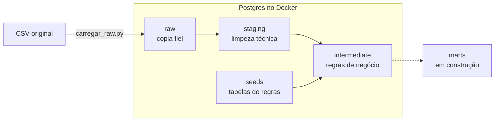

# Marketplace de brechó: pipeline de dados

Pipeline de engenharia de dados para um marketplace de roupas de segunda mão.
O projeto pega uma base de **38.582 anúncios** cadastrados por vendedoras, com
texto livre, encoding quebrado e preços em formatos misturados, e transforma
em dados limpos, padronizados, testados e prontos para análise ou modelagem.

> 🚧 Em construção. Próximas etapas no [roteiro](#roteiro).

## Por que este projeto

Na faculdade, trabalhei com esta base num notebook do Google Colab: limpei os
dados e criei regras para padronizar marcas, cores, tamanhos e tipos de peça,
tudo à mão, em Python. Neste projeto, refaço esse trabalho do jeito que ele
seria feito em produção: com camadas, regras de negócio versionadas em tabelas,
testes automáticos e um ambiente que qualquer pessoa consegue reproduzir.

O problema central é comum em marketplaces: **cada vendedora escreve do seu
jeito**. A mesma marca aparece como "Zara", "zara", "zaraa" e "zara woman";
o mesmo tamanho como "P", "p" e "36"; a mesma condição como "Novo com etiqueta"
e "nova com etiqueta". Sem padronização, não dá para filtrar, agrupar ou comparar.

## Arquitetura



| Camada | O que faz | Materialização |
|---|---|---|
| **raw** | Cópia fiel do CSV. Nenhum valor é alterado. | tabela |
| **staging** | Corrige encoding, limpa espaços, converte preços para número, transforma vazios em nulo. Sem regras de negócio. | view |
| **seeds** | As regras de negócio, em CSVs editáveis: condição, marca, tipo de peça, cor, tamanho. | tabela |
| **intermediate** | Aplica as regras. Cada campo padronizado fica ao lado do valor original e do método usado. | view / tabela |

## Tecnologias

- **PostgreSQL 16** em **Docker**
- **dbt Core** para as transformações, testes e documentação
- **Python** (pandas, SQLAlchemy) para a carga inicial
- **Git/GitHub** para versionamento

## Resultados

| Problema | Antes | Depois |
|---|---|---|
| Textos com acentos quebrados ("Sandália") | 12.467 nomes | 1 |
| Grafias diferentes de marca | 7.106 | 6.490 marcas |
| Valores de condição | 5 | 4 |
| Peças com tipo identificado | – | 38.567 de 38.582 (99,96%) |
| Peças com grupo de cor | – | 38.453 de 38.582 (99,7%) |
| Testes automáticos | – | 54 + 1 aviso |

## Como as regras funcionam

### Três camadas de decisão

1. **Normalização automática:** cada valor ganha uma "chave de comparação"
   (minúsculas, sem acento, sem pontuação). "Maria Filó", "maria filo" e
   "maria filÓ" viram a mesma chave, `maria filo`.
2. **Escolha automática:** entre as grafias de uma mesma chave, vale a mais
   comum que tenha letra maiúscula ("Zara" ganha de "zara").
3. **Regras de negócio (seeds):** o que a automação não resolve fica num CSV,
   com uma coluna explicando o motivo de cada regra. A regra sempre vence a
   automação.

### Rastreabilidade

Nenhuma informação é sobrescrita. Para cada campo, a tabela final guarda:

| Coluna | Exemplo |
|---|---|
| valor original | `sem etiqueta` |
| valor padronizado | `Sem marca` |
| método | `mapeamento` |
| palavra que decidiu | `jeans` |

Assim, qualquer resultado pode ser explicado e, se estiver errado, sei
exatamente qual regra mudar.

### Seeds de regras

| Seed | Regras | Origem |
|---|---|---|
| `map_condicao` | 5 grafias → 4 condições, com ordem de conservação | notebook original |
| `map_marca` | grafias oficiais, erros de digitação, linhas de marca | notebook + revisão |
| `map_marca_inferida` | termos que indicam a marca em peças "sem etiqueta" | notebook original |
| `map_tipo_peca` | ~440 palavras → 21 tipos de peça, com prioridade | notebook original |
| `map_cor` | ~160 palavras → 18 grupos de cor | notebook original |
| `map_tamanho` | letras, números, meses e anos, com equivalência numérica | notebook original |

## Decisões e aprendizados

- **O raw é sagrado.** Os dados entram exatamente como vieram, e toda limpeza
  acontece em camadas derivadas. Se uma regra estiver errada, basta corrigir e
  reprocessar.
- **Limpeza técnica separada de regra de negócio.** A staging só conserta o que
  é objetivamente errado (encoding, tipos). Unificar "Zara" e "zara woman" é
  uma decisão de negócio e fica na camada intermediate.
- **Comparação por palavra inteira.** No notebook original, buscar `red` dentro
  do texto fazia "decote a*rred*ondado" virar vermelho (308 peças afetadas, só
  88 eram de fato vermelhas). No pipeline, as regras comparam palavras inteiras.
- **Usar o dado informado antes de inferir.** O notebook inferia a cor pelo texto
  e descartava a coluna `Cores`, preenchida em 98% das peças. O pipeline usa a
  cor informada e só infere pelo texto quando ela falta, registrando o método.
- **Conflitos detectados automaticamente.** Ao converter os dicionários do
  notebook em seeds, palavras em duas categorias (como "pantalona" em sapato e
  calça) apareceram e foram resolvidas. Testes de unicidade impedem que voltem.
- **Views escondem erros.** A conversão de preço falhava em 51 peças com vírgula
  como separador de milhar ("1,000,00"), mas o erro só apareceu quando uma tabela
  leu a coluna inteira. Um teste agora força a leitura completa dos preços.
- **Imputação não é papel da camada de dados.** Preço vazio fica vazio. Preencher
  com a média é decisão do modelo de ML, numa camada própria de features.
- **Nenhum segredo no Git.** Senhas ficam no `.env`, lido pelo Docker, pelo
  script de carga e pelo dbt. O repositório só tem o `.env.example`.

## Como rodar

### Pré-requisitos

- Docker Desktop
- Python 3.12
- Git

### Passo a passo (Windows / PowerShell)

```powershell
# 1. Configuração
copy .env.example .env          # depois edite o .env e defina uma senha

# 2. Banco de dados
docker compose up -d

# 3. Ambiente Python
py -3.12 -m venv .venv
.\.venv\Scripts\Activate.ps1
pip install -r requirements.txt

# 4. Carga dos dados brutos
python scripts\carregar_raw.py data\raw\roupas_usadas.csv

# 5. Transformações e testes
.\scripts\carregar_env.ps1
dbt build
```

O resultado esperado do `dbt build` é `PASS=54 WARN=1 ERROR=0`. O aviso lista
10 peças cujo preço no brechó é maior que o da peça nova, provavelmente erros
de cadastro.

### Para retomar o trabalho

```powershell
docker compose up -d
.\.venv\Scripts\Activate.ps1
.\scripts\carregar_env.ps1
dbt build
```

### Sobre os dados

A base original não está no repositório: são anúncios de um brechó online
usados num trabalho da faculdade, e não são meus para redistribuir. Para rodar
o projeto, coloque um CSV com as mesmas colunas em `data/raw/roupas_usadas.csv`.

## Estrutura

```
.
├── data/raw/                     # CSV original (fora do Git)
├── scripts/
│   ├── carregar_raw.py           # carga do CSV na camada raw
│   └── carregar_env.ps1          # carrega o .env no terminal
├── macros/
│   ├── criar_funcao_corrigir_encoding.sql
│   ├── generate_schema_name.sql
│   └── normalizar_chave.sql
├── models/
│   ├── staging/                  # limpeza técnica
│   └── intermediate/             # regras de negócio
├── seeds/                        # tabelas de regras (CSV)
├── tests/                        # testes próprios
├── dbt_project.yml
├── profiles.yml                  # conexão, sem senhas
├── docker-compose.yml
├── .env.example
└── requirements.txt
```

## Roteiro

- [x] **Etapa 1:** Postgres no Docker e carga do CSV na camada raw
- [x] **Etapa 2:** projeto dbt e camada de staging
- [x] **Etapa 3:** regras de negócio em seeds (condição, marca, tipo de peça, cor, tamanho)
- [ ] **Etapa 4:** camada final (marts) com modelo dimensional e documentação do dbt
- [ ] **Etapa 5:** fuzzy matching para erros de digitação, com fila de revisão
- [ ] **Etapa 6:** simulação do marketplace (vendedoras cadastrando peças) e orquestração com Airflow
- [ ] **Etapa 7:** "drop" de peças em streaming com Redpanda
- [ ] CI com GitHub Actions